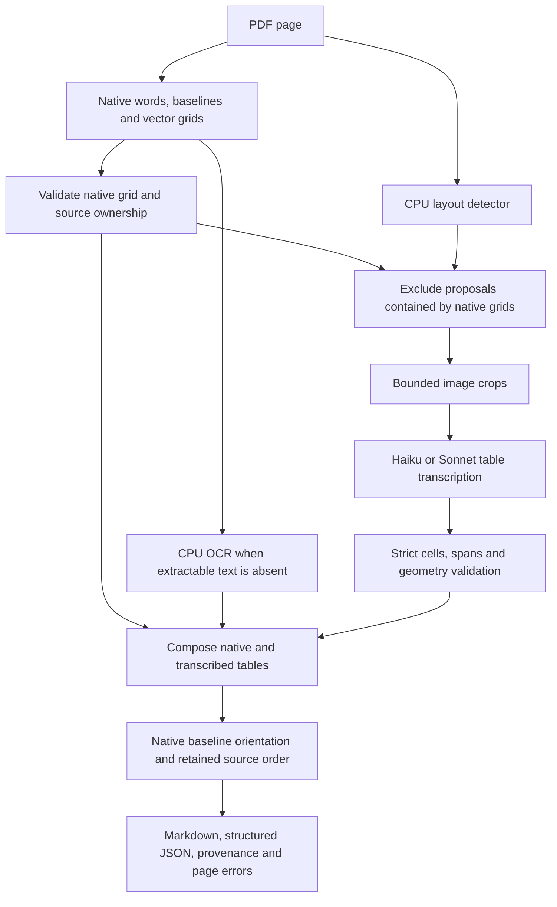

# P002: what the complete pipeline demonstrates

The strongest measured direction is a native-first pipeline with separately
labeled image transcription for remaining table proposals. It preserves fast,
exact native grids and spends inference only on regions that need it. The
276-page DEV expansion also shows that this is not yet dependable extraction
for arbitrary natural documents: dense-page detection, transcription and
repeatability remain material gaps.

The executable entry point and retained artifact contract are described in
[GENERALIZATION_USAGE.md](GENERALIZATION_USAGE.md). Detailed scores, failures,
resource measurements, model usage and cost appear in
[the comparison report](results/generalization-p002.md). All quality tuning is
DEV-only. OmniDocBench page images are raster carriers, not original native PDF
encodings, and these targeted metrics are not an official benchmark score.

## Working pipeline

Model-generated strings are labeled as transcriptions. They do not become
source-owned values merely because their output passes validation. Words fully
inside an accepted transcribed table have explicit superseded ownership; other
words remain literal. Overlapping or malformed table outputs fail atomic page
admission. An optional offline partial-output audit retains isolated valid tables
for review without relabeling failed pages as complete.

## Findings that change the design

- **Preserve exact native structure.** The full Haiku hybrid's raw physical-order
  control recovers 6,604/8,897 exact cells with one false-positive negative page,
  versus 6,329 cells and nine false-positive negative pages for source-ID
  assembly. Its reported API charge is USD 0.0397398 versus USD 0.1275912.
  The rotation correction is audited separately; historical timing and quality
  records remain unchanged.
- **Missing source text is a hard limit for placement models.** Higher-resolution
  OCR substantially increases the available literal vocabulary, but that alone
  does not solve table localization or assembly. Source-only decisions cannot
  supply strings that never entered their evidence. Image transcription can,
  at the cost of losing literal source identity.
- **Detection can dominate the miss count.** The whole-page detector proposes
  nothing on one dense newspaper page containing 26 reference tables. A stronger
  placement prompt cannot recover a region that was never submitted. Multiscale
  detection is a separate experiment, not a gold-informed per-page fallback.
- **Small images have a measurable tradeoff.** Matched Haiku crop edges
  400/512/768/1024 recover 225/290/403/687 exact cells on natural16. The first
  three complete all sixteen page attempts; 1024 has two atomic failures.
  Dense-page gains account for most of the difference. Larger is not a universal
  winner across completeness, cost and text accuracy.
- **Fresh responses vary substantially.** Three Haiku controls have identical
  proposals, crop descriptors and all nineteen request hashes, but recover
  687/289/732 exact cells with 14/14/15 successful pages. Do not attribute these
  differences to the surrounding hybrid architecture or promote a single lucky
  response as a stable configuration.
- **Better prompts can move errors instead of eliminating them.** Column-track
  instructions gain 101 cells on dense pages while losing 27 elsewhere.
  Gated ordinal assembly removes one negative-page false positive but loses
  79 exact cells and one successful page. Publish both effects.
- **Concurrency improves throughput only within its measured scope.** A fresh
  four-worker whole-page Haiku control reaches 30.93 output pages/minute versus
  12.43 serial, with different fresh-response outcomes. Atomic reservations and
  whole-run resource measurements are required; summing overlapping page times
  is invalid. Detector/OCR/hybrid concurrency remains unmeasured.

## Which configuration to use for the next iteration

Use the native CPU route when preserving native words and grids is sufficient.
Use the corrected Haiku hybrid as the next cost-sensitive development candidate;
keep the Sonnet crop configuration as a quality comparator, particularly for
dense tables. Neither choice has protected-set confirmation. Retain explicit
failures and partial-review artifacts rather than silently filling absent cells.

Before production promotion, freeze a candidate and repeat identical-input
measurements, evaluate untouched document families, and check both complete-table
accuracy and negative-page false positives. Prioritize detector coverage on
missed regions, then transcription and cell placement. Additional prompt variants
should be paired with the failure they can actually address.

The experimental assembler currently emits escaped table HTML and literal prose
paragraphs inside Markdown. Its source-conservation checks do not establish rich
formatting, formula semantics, reading-order correctness on every layout, or
pixel visibility. The public library's native `Document.to_markdown()` has a
separate rich-formatting path. Unsupported renderer/font cases remain visible
diagnostics; they are not counted as successful empty pages.
