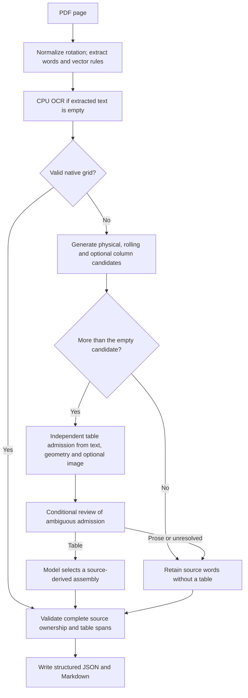

# P001: complete PDF pipeline experiments

Status: implementation and DEV screening, 2026-10-09. This wave has a USD 50
ceiling inside the newly authorized cumulative USD 150 cap. Prior accounting,
including unresolved reservations, is retained. No protected confirmation files
are accessed. Root alone coordinates metered inference.

The previous experiments mostly measured decisions on supplied regions. P001
starts with a PDF page, discovers words and candidate structure automatically,
then emits complete table JSON and Markdown with all remaining source words.
Three parallel worktrees develop the corpus/scorer, whole-page assembly, and
bounded edit policy. Model inputs contain literal source evidence and opaque
source IDs, never family names, reference cells, or scoring feedback.

## Frozen screening design

1. **Native baseline:** preserve vector grids and source text without a model.
   This is the minimal faithful arm. Also measure the opt-in native text-table
   strategy to expose its table/prose tradeoff.
2. **Whole-page assembly:** generate physical, rolling, and seed-band
   alternatives; ask a decision model to select a complete assembly or abstain.
   Compare full-page RGB images at 256, 512, and 1024 pixels on the same pilot.
   A vector-first cascade tests whether reliable geometry can eliminate calls.
3. **Bounded edits:** start with a source-only provisional assembly and offer
   coordinate-addressed row edits or table rejection. Compare one versus three
   neighboring rows, with an evidence-availability legend. At most two model
   edit steps per page; each step validates exact source ownership.

Primary models are Perplexity decider, Clef Flash, and Luna decisions. Live
OpenRouter capabilities and token rates are retained before calls. Hosted APIs
permit this phase without idle GPU rentals; local preprocessing remains CPU-only.
Additional models or prompt arms require a recorded hypothesis before execution.

## Gates and measurement

The corpus agent freezes a balanced pilot and a broader DEV cohort before any
model output is scored. Construction references stay separate from inference.
Natural pages with incomplete references are diagnostic-only. Synthetic siblings
are correlated, and none of these results establish independent generalization.

Primary quality is exact complete table structure per scored page. Also report
positive-table pages separately from negative pages, exact cell and span scores,
false-positive tables, candidate recall, failures, and source conservation.
Source conservation is an engineering invariant, not a semantic quality score.
Missing candidates stay in the end-to-end denominator. Image-only inputs without
OCR are explicit unsupported failures, not successful empty extractions.

An experimental improvement requires at least two additional exact positive
pages without additional false-positive pages on the matched pilot; otherwise
retain the baseline and report the tradeoff. This is a screening criterion,
not a significance claim. Broad runs include promising and moderately plausible
arms; selection and subsequent DEV measurements remain explicitly exploratory.

Timing starts before opening each PDF and includes extraction, proposal,
rendering, packet construction, all hosted calls/telemetry, validation, and
writing final JSON/Markdown. Scoring is outside extraction timing. Report pages
per minute using completed output pages and total elapsed pipeline time, and
pages per USD using positive reported charges or labeled catalog estimates.
Also show exact-positive-page rates where possible. API failures and reservations
remain visible; unknown cost is never represented as free.

Record wall time, process CPU time, and sampled process RSS (100 ms interval),
concurrency and runtime. Provider GPU utilization is unavailable for hosted APIs.
Run three independent native timing repetitions; hosted screening is one fresh
transmission per condition, with provider-reported cache usage retained. Local
response replay is disabled. No unsupported precision or latency claims follow
from a single screening pass.

Raw sources, requests, responses, references, outputs, and ledger are ignored
artifacts under `bench/results/pdf-master-artifacts/pipeline-p001/`. Commit code,
designs, aggregate results, and reproducible commands only.

## First screening checkpoint and additional frozen hypotheses

The 32-page PPLX/512 arm recovered 15/16 positive pages exactly and falsely
admitted tables on 4/16 negatives. Clef Flash/512 recovered 5/16 with no negative
false positives. PPLX/256 and Luna/256 or /512 recovered the same 15/16 with
4/16 negative false-positive pages. These are exploratory paired observations.

Before further calls, add these mechanisms as separate arms:

- **Orientation normalization:** inspect the source page's `/Rotate`, set it to
  zero on the runner-owned loaded document, then extract and render consistently.
  This changes both evidence coordinates and pixels together. Synthetic 90/180/270
  checks preserve source words and match normalized image hashes. No source file
  or private target is changed. This addresses a candidate-discovery failure;
  larger model images cannot select a correct candidate that is absent.
- **Independent admission:** ask table/prose/unresolved from full source evidence
  before showing assembly hypotheses, then assemble only admitted pages. Compare
  minimal and relational premises; the latter asks whether rows share a record
  and attribute schema or whether prose flows independently down columns. Charge
  both calls. Reliable vector grids retain the native fast path.
- **Adaptive evidence:** source-only column conflicts, sparse/wrapped rows and
  text density select repair versus whole-page assembly and 256/512/1024 pixels.
  Context expands to three rows for observable wrapping ambiguity. Frozen rules
  contain no family names, source identities, expected text or private outcomes.

The six packet refusals from source preflight remain recorded: five oversized
complete packets and one incomplete native span tiling. Image-only sources without
OCR are explicit unsupported cases. A successful output conserves extractable
snapshot words, which does not establish preservation of unmapped glyphs or pixels.

## Broader runs and remaining controls

The normalized PPLX/256 pilot recovered 16/16 positives. Independent admission
reduced negative false positives from four to one for both PPLX premises; Luna's
1024-pixel gate also reached 16/16 with one false-positive page. Local row edits
and the first adaptive routing policy retained only 10–12/16 positives, with
5–6 false-positive pages. Preserve these losses rather than promote that policy.

Next, run the fixed complete corpus with native, model-only, geometry cascade,
independent gate, and adaptive controls. Include the promising PPLX and Luna
routes and retain a lower-recall Flash comparison. These are broader DEV runs,
not a newly untouched or independent confirmation set.

Additional declared controls before execution:

- Matched Opus/Sonnet/Haiku 5.5 choose from exactly the same source-derived
  assemblies. This compares complete constrained pipelines, not unrestricted
  frontier extraction. Output schemas change transport only; no probabilities
  are fabricated for chat models.
- Empty-text OCR uses native CPU RTen at 150 dpi with four threads. Load lazily,
  charge initialization and recognition to the pipeline, preserve input bytes,
  and keep zero-recognition pages explicitly unsupported. The source-only probe
  recovered text on one of three empty pages; semantic accuracy is still scored.
- A reading-order admission premise compares the unchanged native sequence with
  mechanically formed horizontal bands. Both views contain each source ID once.
  This tests whether coherent prose continuation can disambiguate aligned columns.
- A separate gate-review cascade invokes Sonnet only when the initial gate's
  maximum score is below 0.8 or its top-two margin is below 0.25. These fixed
  exploratory thresholds are uncalibrated heuristics motivated by a DEV miss,
  not probabilities of correctness. The reviewer sees the same source evidence,
  without the first model's answer or any reference. Count every review call.
- Adaptive and gated arms skip a model when only one complete candidate exists:
  the model's declared menu cannot alter that output. Missing positive candidates
  remain failures in structural scoring. This saves calls without adding evidence.

## Reproduce the complete path

The measured gated pipeline uses source evidence at each stage:



Any resource refusal, invalid structure or malformed model response remains an
explicit page failure. Successful source conservation covers extracted words;
it does not establish OCR accuracy or semantic reading order. The current scored
positives each contain one reference table. Mixed pages with both a valid vector
grid and an additional borderless table need a separate test of the native fast
path, which currently accepts retained vector grids before model admission.

Build DEV sources and separate construction references:

```bash
.venv/bin/python -m bench.pipeline_corpus --directory bench/results/pdf-master-artifacts/pipeline-p001/corpus
```

Run the measured experimental pipeline, including all page preparation, OCR when
needed, decision calls, validation and output writing. Hosted execution spends
from the persistent ledger; use a fresh output directory for each condition.

```bash
.venv/bin/python -m bench.pipeline_run \
  --manifest bench/results/pdf-master-artifacts/pipeline-p001/corpus/manifest.json \
  --output bench/results/pdf-master-artifacts/pipeline-p001/example-reviewed \
  --policy gated --model perplexity/pplx-decider-v1.1-27b \
  --image-edge 256 --normalize-rotation --ocr-empty \
  --gate-review-model anthropic/claude-sonnet-5.5
```

Add `--pilot` for the predefined 32-page screen; use `--policy native` for a
CPU-only baseline. Inference does not load private targets. Score retained outputs
locally in a separate step:

```bash
.venv/bin/python -m bench.pipeline_report \
  --directory bench/results/pdf-master-artifacts/pipeline-p001 \
  --output bench/results/pipeline-p001.md
```

The offline demo pairs a source image with native and selected table structure,
Markdown, source ownership and provenance. It opens as a standalone HTML file:

```bash
.venv/bin/python -m bench.pipeline_demo \
  --run bench/results/pdf-master-artifacts/pipeline-p001/pilot-oriented-pplx-256 \
  --page p16e14ea079d4c7949923 \
  --output bench/results/pdf-master-artifacts/pipeline-p001/demo-wrapped \
  --image-edge 1024
```

This research runner is opt-in; the package's default extraction path does not
make hosted calls. It emits HTML tables inside Markdown to retain merged spans.
It preserves remaining extracted words as paragraphs without claiming recovered
heading, list, link, mathematical or semantic header roles.

## Pilot re-evaluation and next hypothesis

Selective Sonnet review matched the 32/32 exact pages of direct Sonnet and Opus
with one review call. Perplexity gating alone reached 31/32; adding a second
reading-order view did not close that remaining gap. These thresholds were
chosen after DEV observations and remain exploratory. For normalized choice
scores summing to one, the 0.25 margin trigger is redundant with the 0.8 maximum
score trigger; these are not two independently established uncertainty signals.

The full source audit found an additional proposal ceiling: CPU OCR recovered
the strings of a sparse table, but existing gap corridors placed some strings in
adjacent columns. A separate optional experiment will offer column-consensus
alternatives using observed centers/edges and header geometry. It must retain
existing candidates, use no reference strings or fixture identities, and remain
a hypothesis for a model to select rather than force a table from aligned prose.
Compare it only as a distinct proposal version, preserving the original wave.

The next complete-corpus layer separates treatments before combining them:

- Vector-first PPLX cascade supplies the previously declared geometry-only routing
  control, without the independent admission question.
- PPLX gating with column-consensus alternatives tests proposal reachability.
  A separate reviewed version combines only the column fix and conditional Sonnet
  review, leaving the original evidence format intact.
- PPLX gating with a compact assembly packet tests whether exact source/ownership
  references reduce duplicated evidence without losing selection quality.
- Repeat compact PPLX gating without images to test whether the pilot's geometry
  and text result survives the broad corpus. The compact prompt describes images
  conditionally, and admission explicitly records their availability.
- Column consensus plus compact packets plus conditional Sonnet review combines
  the fixes to different observed failure stages. Compare a direct Sonnet arm
  using the same augmented candidates and compact evidence as well.
- A conditional Haiku review arm tests whether the admission subtask needs the
  more expensive Sonnet reviewer. All review calls and failures count.

Compact packets preserve full source text, IDs, geometry and candidate topology;
they may replace repeated cell text with source-ID references, but cannot truncate
evidence or round coordinates. Record remaining admission refusals. Each run
freezes these optional settings and implementation hashes. Original full-corpus
runs remain unchanged and are reported alongside these DEV-selected derivatives.

## Follow-up priorities beyond this finite wave

One additional derivative is declared after the completed compact-packet result:
the lossless dictionary/index format reduced PPLX exact positives from 34/35 to
31/35 with four false-positive pages unchanged. A **readable deduplication** arm
will retain explicit literal words and exact coordinates, removing only repeated
candidate text/topology. It must preserve all alternatives, source ownership and
the 25,000-character complete-packet boundary. Compare column consensus plus the
same gate and Sonnet review using this new format against the original and compact
formats. No references or specific failed-cell strings enter the new prompt.

Keep the older mechanisms available; poor performance of a whole-page policy does
not establish that its component is useless in a narrower role. In particular:

1. Test coordinate edits and rolling-row state **inside an independently admitted
   table**, where prose false positives no longer dominate. Compare complete-row
   replacement with smaller merge/split edits and require literal ownership after
   every operation.
2. Add separately frozen mixed-table pages, multiple tables, sparse records and
   multi-page continuations. The native fast path must account for borderless
   content outside accepted vector grids instead of silently ending discovery.
3. Distinguish missing source evidence from missing placement alternatives. Probe
   PDF accessibility mappings/font metadata before another OCR route when words
   are absent; use source geometry and bounded crops when strings already exist.
4. Test a bounded larger-answer retry only for provider truncation, retaining both
   attempts and charges. One Sonnet control used all 1,024 completion tokens on
   reported reasoning and emitted no valid choice. This is a transport/answer
   budget failure, not evidence of a wrong semantic decision.
5. After choosing a configuration using DEV only, obtain custodian-run independent
   confirmation on genuinely different documents. Do not turn these correlated
   silver scores into a general extraction accuracy claim.

These are documented next experiments, not completed results or implied spending
commitments. No protected confirmation data was used to create them.
